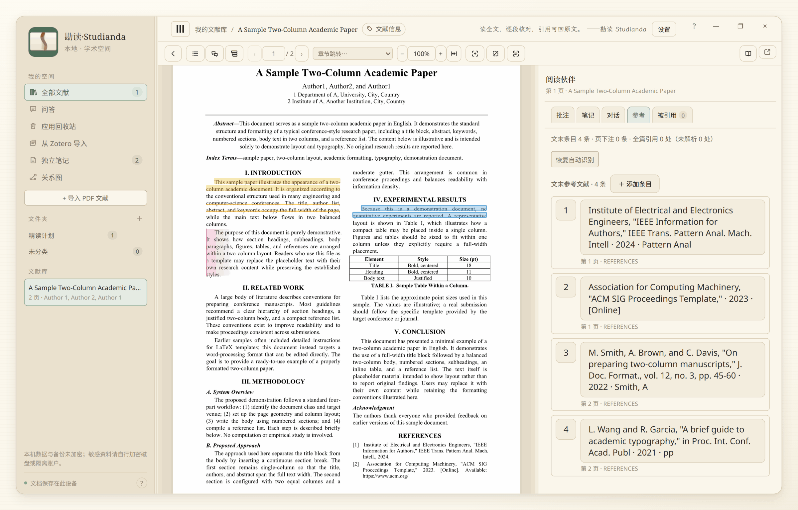
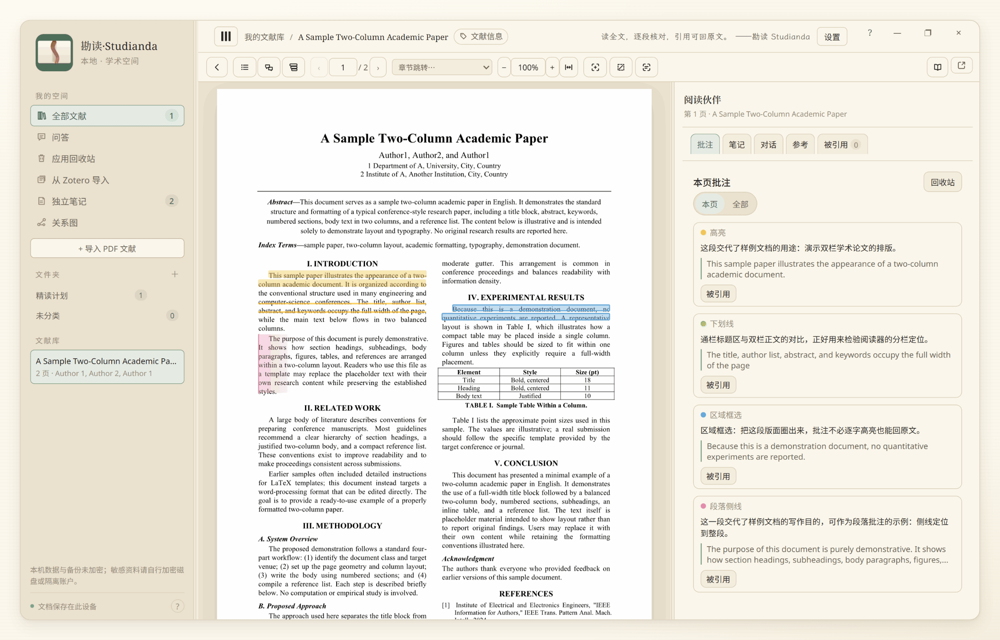
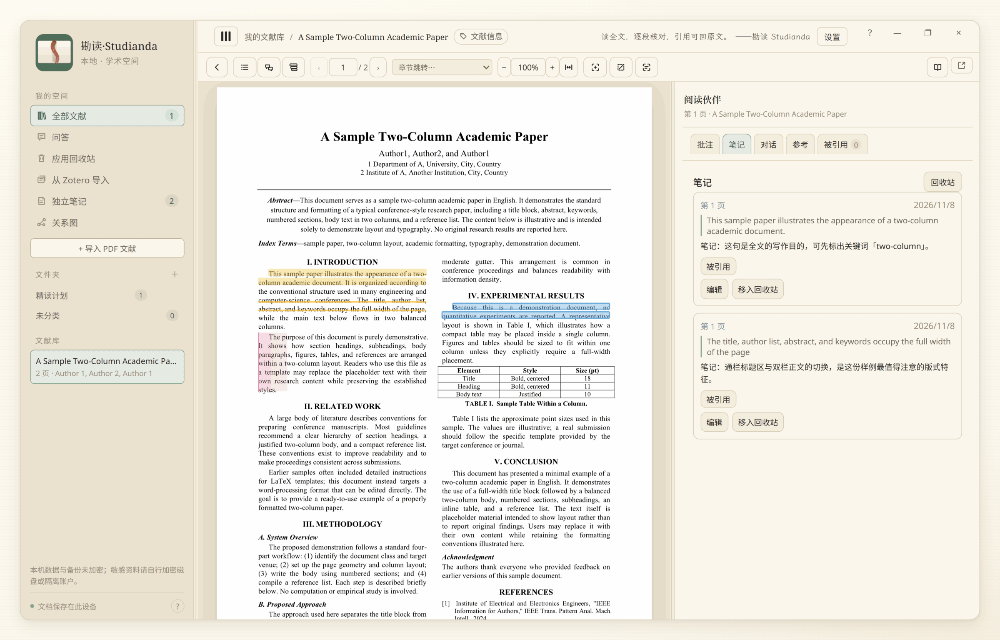
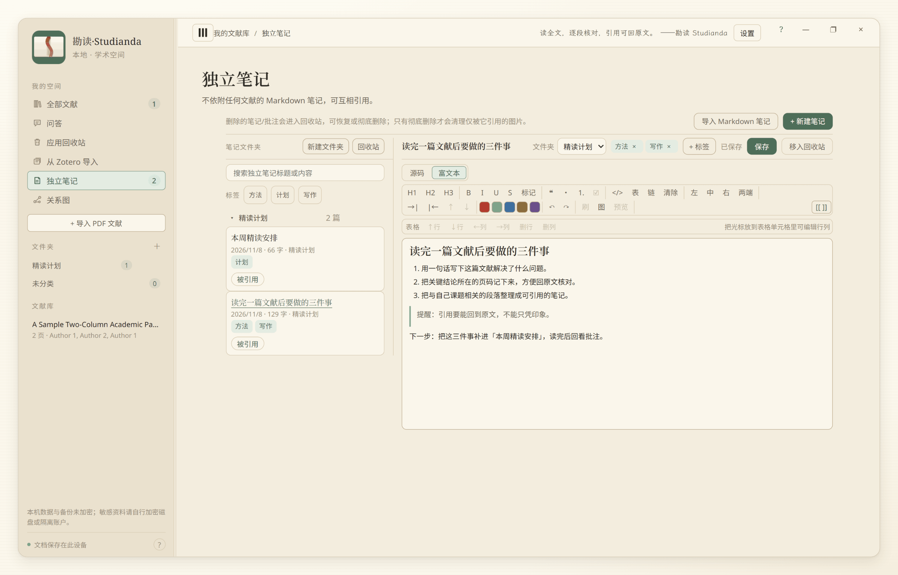
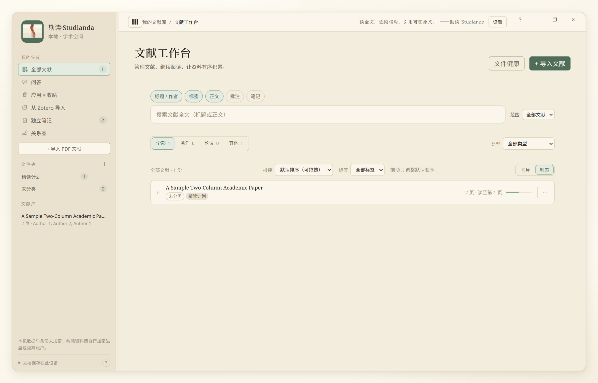
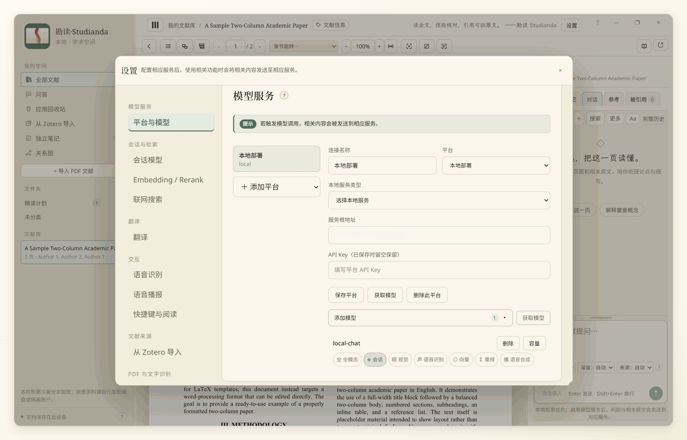
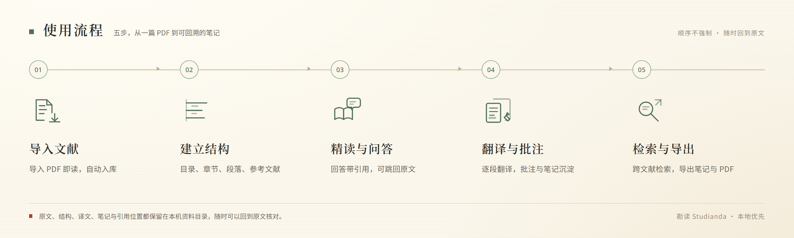

  

<h1 align="center">勘读 Studianda</h1>

  <strong>读原文、核证据、留痕迹，把阅读与思考积累起来——本地运行的学术阅读工作台。</strong> 
  「勘读」是边读边校；Studianda 取自新拉丁语 <em>studianda</em>（有待研习之事）。取科研永远处于正在进行时的意思。

勘读（Studianda）是一间放在本机的学术书房：导入 PDF，按范围精读，向「阅读伙伴」提问；回答里的引用带页码，点击能跳回原文页。翻译、批注、笔记与扫描件 OCR 都在同一个窗口完成，数据默认存在你自己选的资料目录。

  <a href="#为什么是勘读">为什么</a> ·
  <a href="#界面一览">界面</a> ·
  <a href="#快速开始">快速开始</a> ·
  <a href="#更新">更新</a> ·
  <a href="#核心能力">能力</a> ·
  <a href="#数据与隐私">数据与隐私</a> ·
  <a href="#ai-标识与导出">AI 标识</a> ·
  <a href="#适用人群与使用边界">适用人群</a> ·
  <a href="#常见问题">常见问题</a> ·
  <a href="#参与开发">参与开发</a> ·
  <a href="docs/USAGE-NOTICE.md">使用须知</a>

## 为什么是勘读

**可回溯式会话，引用回得了原文。** 回答里的引用带编号与页码，点击跳回原文页，悬停还能看到文献名、章节与摘引。阅读链路会逐字核验证据，缺证单独标出，不当作已核实。

**本地优先，数据默认留在本机。** PDF、笔记、批注、会话与译文都写进你选定的资料目录，资料位置可以整体迁移。外部服务默认关闭（安装版启动时的更新检查除外，见[更新](#更新)）；只有你主动配置后，相应内容才会发给对应服务方。

**独特的会话策略使回答尽可能完备，按范围读原文，分批读完。** 长文献按本页附近、章节或整篇分批阅读，读不完的页面会保留，下一轮可以「继续阅读」。需要跨篇论证时再显式选择跨文献精读。

**让阅读与思考真正积累起来。** 批注、笔记、独立笔记与会话记录都写进资料目录；反向引用、关系图与检索把它们串起来，读得越多，自己的材料库越厚。

## 界面一览

  

阅读页。左侧读原文，右侧「参考」列出文末参考文献与所在页；点击条目可跳到原文位置。

  
  

左：高亮、下划线、区域框选与段落侧线都在原文上完成，右侧批注按页列出。右：阅读中的想法可以随时存成文献笔记。

  
  

左：独立笔记，Markdown 编辑、标签与反向引用。右：文献库，列表或卡片视图、文件夹与阅读进度。

  

设置里按用途配置模型与路由。

## 快速开始

1. **安装**：从 [GitHub Releases](https://github.com/SNLCC/studianda/releases) 下载 Windows 安装包（`Studianda-Setup-<版本号>.exe`）；安装包在对应 Release **发布后**才可下载，安装后打开「勘读」。
2. **选资料目录**：首次启动选择一个文件夹，文献、笔记与数据库都放在这里；卸载程序不会删除它。启动页需先打开并勾选确认[使用须知](docs/USAGE-NOTICE.md)，同时确认年龄声明（已年满 18 周岁，并知悉本工具不面向未成年人），之后才能开始使用。
3. **导入 PDF**：在文献库点「+ 导入文献」，选一篇 PDF 就能开始阅读。
4. **按需配置模型**：设置 → 模型服务。

> 当前发布目标是 Windows；尚未对 macOS 进行打包与实测。

## 更新

安装版启动后默认不会自动检查更新；可在「设置 → 关于与更新」开启。开启后发现新版本时，界面会提示新版本号与安装包大小，可以选择「立即更新」在应用内下载，下载完成后重启完成安装；只发送版本号等更新元数据。也可以用环境变量 `STUDIANDA_DISABLE_UPDATE_CHECK=1` 强制关闭。

- **资料不受影响**：更新只替换程序目录，文献、笔记、数据库与设置都在你选的资料目录里，不会被覆盖。
- **更新前自动备份**：应用在安装更新前会先备份资料；备份失败会先询问，不会直接覆盖。
- **未签名提示**：当前安装包未做代码签名，首次运行（包括更新后的首次启动）Windows 可能提示「未知发布者」，选择「更多信息 → 仍要运行」即可。
- **手动更新**：可以下载最新安装包后覆盖安装。

详细发版与回滚策略见 [docs/RELEASE.md](docs/RELEASE.md)。

## 使用流程

  

1. **导入**：选择 PDF，文献复制进资料目录。
2. **建结构**：识别目录页或书签、章节、段落与参考文献。
3. **精读**：按章节或整篇阅读，随时向阅读伙伴提问。
4. **核对**：点击引用跳回原文。
5. **沉淀**：翻译、批注、笔记、检索，需要时可以导出。

## 核心能力

### 精读与会话

阅读伙伴在原文旁边工作：按页、按章或整篇读，回答带可回原文的引用。

- 按本页附近、章节或整篇精读；长文献分批读，未读页可「继续阅读」。
- 回答带引用编号，点击跳回原文页；逐字核验证据，缺证单独标出。
- 每篇文献独立多会话；自动压缩历史，可搜索、分页、重新生成、存为文献笔记。

### 目录、结构与参考文献

先把文献的结构建立起来，后面的阅读、检索和引用才有落点。

- PDF 有书签目录时优先显示；也可用书前目录页（如 `3-5`）识别标题与印刷页码，自动对齐物理页码。
- 识别章节、段落、列表、题注、公式与脚注；支持折行标题、双栏与罗马数字页码。
- 识别文末参考文献与页下注，正文引用可点击跳转，条目可编辑、删除、手动新增。

### 文献库、检索与 从Zotero导入

文献、文件夹、标签与阅读进度集中在一处，适合长期积累。

- 导入 PDF，自动复制进资料目录；文件夹、标签、分类、回收站与文件健康检查。
- 本机全文检索与语义近似，范围可分全部文献、指定文献或标签；译文也可作为检索来源。
- 可以从 Zotero 导入。

### 批注、笔记与翻译

在原文上留下痕迹，再用笔记把碎片整理成自己的材料。

- 高亮、下划线、段落侧线、区域框选；批注可显示译文，可导出 Markdown 或带批注 PDF。
- 文献笔记与独立笔记分开管理，支持标签、反向引用与全库关系图。
- 翻译本页 / 整篇 / 选文，逐段保存与重译；版式视图把译文放回页面原位，不改原 PDF。

## 数据与隐私

默认留在本机：文献 PDF、SQLite 数据库、笔记与批注、译文、会话记录与检索缓存都写在你选的资料目录。

完整的使用须知、三方角色、逐功能数据流向与风险提示见 **[docs/USAGE-NOTICE.md](docs/USAGE-NOTICE.md)**；下面是常见的几点。

- **笔记与批注默认勾选**：配置模型后提问，勾选的笔记与批注正文会随问题发送；不需要时取消勾选即可。
- **密钥不在资料目录**：模型与其他服务的密钥由你自行向厂商申请，经 Electron `safeStorage` 加密后写入独立的 `userData/secrets.json`（Windows 通常为 `%APPDATA%\Studianda\secrets.json`），不写入资料目录，也不随资料备份。
- **联网搜索与检索规划**：需要你自己配置搜索平台密钥，如果你在「搜索规划隐私策略」里选择把当前问题交给会话模型、或按勾选范围发送内容，规划阶段会把这些内容发给你配置的会话模型。详见使用须知第 6 节。
- **未加密**：资料目录、备份与诊断包都不加密；敏感资料请自行加密磁盘或隔离系统账户。
- **删除与清空**：删除文献会级联清理它的批注、笔记、会话记录与索引；「设置 → 数据与维护 → 清空全部本地数据」会在二次确认后删除全部文献、批注、笔记、会话、译文、检索缓存、备份、诊断包与本地运行日志，并对数据库做 WAL 截断/VACUUM，保留模型配置与密钥。注意备份/回滚目录可能残留旧副本，见使用须知第 4 节。
- **更新检查**：默认关闭；可在「设置 → 关于与更新」开启。开启后安装版启动约 10 秒会向 GitHub 检查更新，只发送版本号等更新所需信息，不包含文献、笔记、批注或会话内容；也可用环境变量 `STUDIANDA_DISABLE_UPDATE_CHECK=1` 强制关闭。
- **使用须知**：首次启动展示[《使用须知与隐私说明》](docs/USAGE-NOTICE.md)，同时作为使用条款与隐私说明；继续使用即表示你已阅读并理解。第三方服务的权利义务以其服务协议为准。
- **AI 生成内容可能出错**：回答、译文与摘要都由模型生成，引用可回到原文核对，但「有引用」不等于「已核实/真实可靠」。
- **不联网也能用**：部分基础功能可离线使用。

## 第三方 AI 服务与责任边界

- **本工具不提供 AI 模型或生成能力**：本工具是本地阅读工具；AI 功能由你自行配置的第三方模型服务或本机模型提供；项目方不持有模型、不代收模型费用。
- **生成内容的合规性与标识义务由对应 AI 服务提供者承担**：本工具不替代模型服务方的备案、审核、内容处置与投诉等义务。
- **你使用本工具生成、传播内容，需自行遵守相关法律法规及科研诚信要求**；不得删除、篡改、伪造或隐匿 AI 标识。**请勿把本工具用于对外提供咨询、内容生成或其他生成式 AI 服务**；如违反，使用者自行承担相应责任。

## AI 标识与导出

- **界面显式提示**：每条 AI 回答顶部标注「AI 生成 · 内容可能出错，请核实」；译文区标注「机器翻译 · 由 AI 生成，可能出错，请核对原文」，OCR/视觉解读结果也有机器识别提示。
- **复制带标识**：回答的「复制回答」、译文的「复制译文」与 OCR 文本复制都会自动附带 AI/机器识别标识文字，避免无感知地传播没有标识的生成内容；复制内容由代码强制追加，没有“一键去除”开关。
- **导出带标识**：导出 Markdown 会在**文件开头**强制写入 AI 生成声明、学术披露提示与隐式注释。
- **不去标识**：不提供删除、篡改、伪造或隐匿 AI 标识的功能；导入、导出与 OCR 链路不清洗第三方 AI 标识。应用不提供去标识开关或批处理去标识能力。
- **学术披露**：使用 AI 辅助阅读、翻译、写作或整理时，请按相应机构、期刊或学校的科研诚信要求披露使用范围；你（作者）对最终内容负责。

## 适用人群与使用边界

- **面向成年专业用户**：研究者、教师、学生与写作者。导入内容的合法性、对第三方服务条款的遵守，由你自己负责。
- **用途与场合**：个人学习文献阅读、翻译、批注、笔记和会话辅助；**请勿用于**对外提供生成式 AI 服务，**不用于**医疗、法律、金融等专业结论，也不替代原文证据。
- **不面向未成年人**：不面向未成年人提供服务与推广，也不进入校园渠道，不提供面向未成年人的功能或监护人模式。首次启动会要求确认「已年满 18 周岁，并知悉本工具不面向未成年人」——这是使用确认，不是身份核验。
- **机构用户**：当前暂不接受机构用户；如未来开放机构使用，机构对外提供服务时需自行履行相应义务。
- **第三方服务**：相应服务由对应厂商负责；请自行判断其合规状态（例如是否已备案）与数据处理规则。请**仅接入依法合规运营服务**；**不建议使用第三方中转/代理**；请勿接入未备案/未合规服务、来源不明的共享 Key 或中转端点，相关数据传输风险与合规责任由你自行承担。

## 安全漏洞

安全漏洞请勿公开提交。

## 常见问题

<strong>可以免费用吗？</strong>

项目按 **PolyForm Noncommercial 1.0.0** 发布：个人学习、教学、公共研究等非商业用途可以使用、修改与再分发（需随附许可条款与 NOTICE）；商业使用需单独授权。模型、搜索等第三方服务的费用由你自己的账号承担。

<strong>我的文献会被上传吗？</strong>

默认不会。只有你主动配置并启用模型、在线解析、联网搜索、语音模型或 Zotero 云端/WebDAV 等外部服务时，相应内容才会发给对应服务。笔记与批注默认勾选，配置模型后提问会随问题发送；不需要时取消勾选即可。逐项「发送什么、发给谁、默认是否开启」见 [使用须知](docs/USAGE-NOTICE.md) 的数据流向表。

<strong>不配置模型能用吗？</strong>

能。导入、目录与结构识别、阅读、本机检索、批注、笔记、备份与导出等功能都不需要模型。本机检索覆盖文本层 PDF；扫描件需先在设置中下载本机 OCR 语言包（不随包分发），完成文字识别后才能检索。AI 会话、翻译与摘要压缩需要模型服务；没有配置时，阅读伙伴只返回本机检索到的原文。

<strong>支持哪些文件格式？</strong>

文献暂时只支持 PDF。笔记支持 Markdown 导入与编辑，可导出笔记与批注的 Markdown，或带批注的 PDF 副本。

<strong>支持 macOS 吗？</strong>

尚未对 macOS 进行打包与实测。

<strong>如何备份、换电脑或换目录？</strong>

「设置 → 数据与维护 → 数据备份」可以创建、校验与恢复备份，恢复在下次启动时生效。换目录用「资料位置」迁移：选择空文件夹，复制到新位置后切换指针，原目录保留作安全备份；注意：备份与资料目录都未加密。要清空数据，用「设置 → 数据与维护 → 清空全部本地数据」：二次确认后会删除文献、批注、笔记、会话记录、译文、检索缓存与备份，保留模型配置与密钥。

<strong>如何更新到新版本？</strong>

安装版可在设置中开启自动检查更新；开启后发现新版本时按界面提示下载并重启安装即可；更新只替换程序目录，不会动资料目录，安装前还会先备份资料。也可以手动下载新版安装包后覆盖安装。当前安装包未签名，Windows 可能提示「未知发布者」，选「更多信息 → 仍要运行」。更新检查默认关闭，可在设置开启；开启后只发送版本号等元数据，可用环境变量 `STUDIANDA_DISABLE_UPDATE_CHECK=1` 强制关闭。详细流程见 [docs/RELEASE.md](docs/RELEASE.md)。

## 参与开发

当前 Pull Request 功能暂时关闭，暂不接受代码、文档、翻译、设计等贡献，也暂不需要签署 CLA；欢迎通过 issue 报 bug 或提建议。反馈规范与将来恢复贡献时的要求见 [CONTRIBUTING.md](CONTRIBUTING.md)。

涉及联网功能与产品定位边界的改动，另见 [CONTRIBUTING.md](CONTRIBUTING.md) 与 [docs/USAGE-NOTICE.md](docs/USAGE-NOTICE.md)。

## 许可

- 项目自身代码按 **PolyForm Noncommercial License 1.0.0** 发布（见 [LICENSE](LICENSE)、[NOTICE](NOTICE)）：非商业用途可以使用、修改与再分发（需随附许可条款与 NOTICE）；**这不是 OSI 开源许可证**，商业使用需单独授权。
- 第三方组件仍适用各自许可证：清单与原文见 [`legal/THIRD-PARTY.md`](legal/THIRD-PARTY.md)、[`legal/NOTICE.html`](legal/NOTICE.html)、[`legal/inventory.json`](legal/inventory.json)。
- Windows 安装器内嵌 NSIS 7z 解压插件 `nsis7z.dll`（基于 7-Zip 19.00 源码，按 7-Zip License / LGPL-2.1+ 与 unRAR 限制分发）及 StdUtils / UAC / WinShell 等 NSIS 插件；对应许可、来源与源码见 [`legal/upstream/official/nsis7z/`](legal/upstream/official/nsis7z/README.md) 与 [`legal/upstream/official/nsis-plugins/`](legal/upstream/official/nsis-plugins/README.md)，第三方许可与项目许可的兼容性说明见 [`legal/COMPATIBILITY.md`](legal/COMPATIBILITY.md)。
- 本机 OCR 使用 `tesseract.js`（Apache-2.0）；语言训练数据来自官方 `tesseract-ocr/tessdata_fast`（Apache-2.0），**不随仓库或安装包分发**，只在你于设置中主动下载时联网获取。
- 界面内置开源中文字体，按相关协议分发。
